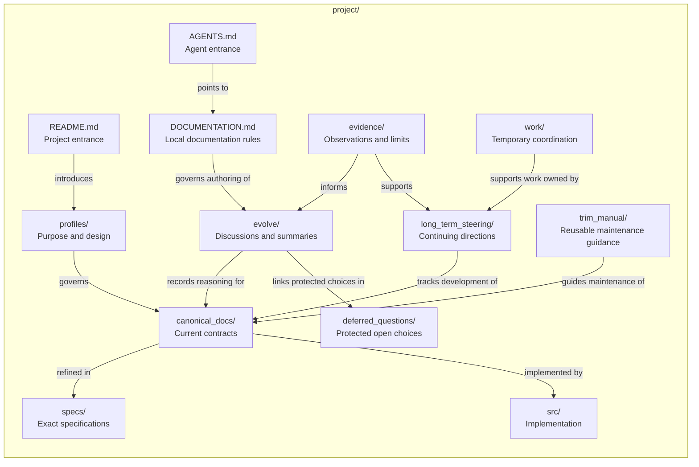

# A Working Guide to Project Documentation

This recipe records the maintainer's preferred documentation practice developed
through work with Mindflow. It offers a coherent working default for keeping
purpose, commitments, implementation, evidence, and developing questions
understandable together.

**Project-local design, terminology, and maintained instructions take priority
over this guide.** Use its recommendations where the project leaves a choice,
and adapt them deliberately when establishing or revising local practice.
Keep adopted rules in the project's own guidance so they remain usable without
Structuralist. Consulting the recipe does not authorize project changes.

Read the relevant part for the task:

- [The recipe at a glance](#the-recipe-at-a-glance)
- [Organization and authority](#organization-and-authority)
- [Change routing](#route-each-change)
- [Development practice](#working-through-development)
- [Writing for the reader](#writing-for-the-reader)
- [Mindflow alignment](#using-mindflow)
- [Maintenance and completion](#maintenance-and-completion)
- [Fieldbook illustration](#fieldbook-in-practice)
- [Asset adaptation](#adapting-the-assets)

## The recipe at a glance

Here is one fuller documentation arrangement, shown as a Mindflow-style
Structure view. The outer box is the project folder; entries are files or
collapsed folders, and labeled arrows describe relationships between them.



This is a suggested layout, with selected relationships. Project-local design
and guidance take priority: combine, rename, or omit owners as needed, and keep
tests and evidence beside their actual artifacts. A temporary work folder is
useful only while it carries authorized work. The compact Fieldbook example
below combines several of these responsibilities in `project.md`.

## Organization and authority

Give each maintained commitment one current owner. Link to that owner from
other perspectives, discussions, and instructions. Make the authority between
owners explicit: a design principle guides a behavioral contract; an exact
specification refines that contract; implementation realizes it; evidence can
pressure any of them and prompt a deliberate revision.

Keep the project's documentation rules at one ordinary owner, commonly
`DOCUMENTATION.md` or a section of the project account. That owner explains
responsibilities, authority, change routing, and maintenance obligations.
Update it when those rules change. Keep present results, active plans, and
historical accounts with the owners below. Let `README.md` orient the reader
and `AGENTS.md` provide a concise working entrance with links to local guidance.

Use this separation of responsibilities:

| Responsibility | What it maintains | Relationship to the rest |
| --- | --- | --- |
| Purpose and design perspectives, often `profiles/` | The problem, design insights, principles, tradeoffs, and durable boundaries | Guide current commitments; distinct perspectives may examine the same subject |
| Readable current contracts, often `canonical_docs/` | Accepted meaning and behavior, including inputs, outcomes, constraints, lifetime, and relevant failure | Own what implementations must satisfy; distinguish that commitment from current coverage |
| Exact specifications, often `specs/` | Schemas, signatures, encodings, and procedures whose exact form matters for conformance | Refine one named current contract and remain subordinate to its meaning |
| Implementation and direct checks | Realized behavior and the checks that exercise it | Demonstrate coverage and expose gaps against the applicable commitments |
| Evidence accounts | Observations, conditions, reproduction, comparisons, and limits beside their actual artifacts | Support scoped conclusions and preserve counterevidence for reconsideration |
| Continuing direction, often `long_term_steering/` | Intent, current understanding, the question worth pursuing, and where results belong | Select and interpret further work using project-owned methods; link commitments and evidence |
| Event discussions and summaries | Questions, alternatives, changed understanding, decision reasons, and historical synthesis | Explain how the project arrived here and link accepted consequences to their current owners |
| Protected deferred choices | An unresolved consequential choice, current safe boundary, and evidence for revisiting it | Preserve a deliberate open boundary until an authorized decision reaches its owner |
| Temporary scaffolds | Active plans, checklists, and bounded working reviews for an accountable task | Coordinate work; release them when useful results have been absorbed |
| Reusable maintenance guidance | A procedure learned from a recurring documentation pressure | Apply the project's rules to future occurrences; keep current findings with the current task |

These responsibilities can share a file. A small project account can carry
purpose, accepted behavior, and working practice. Separate owners when their
authority, readers, or change needs require independent maintenance. Use names
that fit the project; the suggested paths are conventions, not folders to
create in advance. Create a standing layer when an ongoing responsibility
makes it worth maintaining. A useful development can deserve an Event without
creating another documentation layer.

When owners disagree, identify the actual decision boundary. Reconcile an
exact specification with its governing contract. A mismatch between behavior
and commitment calls for an implementation correction or an authorized change
to the commitment. Preserve live disagreement and uncertainty until that choice
is made. Evidence supplies a reason to reconsider; existing behavior does not
silently settle the intended design.

*Fieldbook combines purpose, browsing behavior, and local methods in
[one project account](../assets/recipe/compact/project.md). Its evidence and
Event reasoning have separate owners because readers need to inspect them
independently. It does not need the full set of suggested directories.*

## Route each change

Read the affected owner and its relevant dependencies before editing. Use the
kind of change to decide which consequences must travel together:

| Change | Working rule |
| --- | --- |
| Purpose, design principle, or accepted boundary | Retain the meaningful alternatives and reasons in a discussion; revise the governing account and affected contracts |
| Meaning or observable behavior | Update the current contract and affected exact specifications, implementation, and checks; if design intentionally precedes realization, state the remaining coverage gap at its ordinary owner |
| Exact representation with unchanged meaning | Update its specification, implementation, and checks; confirm that the readable contract remains accurate |
| A defect within an established commitment | Repair the behavior and run relevant checks; correct documentation only where its account is wrong |
| New observations or a revised claim | Keep conditions, results, and limits at the evidence owner; update affected conclusions and retain useful changed interpretation in an Event |
| A developing question or continuing direction | Preserve the question and current basis for choosing work; give a protected unresolved choice its safe boundary and revisit condition |
| A working method or documentation convention | Revise the local guidance that owns it; retain the reason for a consequential change where it can be revisited |
| Explanation or navigation | Improve the owner and affected links; preserve its meaning and reader purpose |

One change can touch several rows. Follow its consequences across those owners
without copying the same rule into each. Routine repairs and editorial changes
need no new Event, steer, or research campaign. A discussion is useful when its
reasoning will help a later reader understand a question or decision.

*In Fieldbook, the browsing choice changed accepted behavior in `project.md`.
The observation stayed in its evidence account, and the Events explain the
choice. Changing only the summary would have left the maintained behavior
without its accepted consequence.*

## Working through development

Start from the actual request and the project's current practice. Establish
what needs to change, which commitments constrain it, and what outcome or
stopping condition would answer the task. When selecting further work for a
continuing direction, compare the relevant alternatives in that direction;
finishing one task does not automatically select its adjacent next task.

Choose methods for the question. Exploration can clarify what to ask;
construction can realize a missing behavior; repair can restore an established
contract; operations can require restoration followed by review. These are
situations with different needs, not project phases. The project maintains
and revises the methods it uses in its own ordinary documents.

Separate the basis for beginning work from the evidence for claiming a result.
An implementation task needs sufficiently clear intended behavior and checks
at the affected boundary; it can supply the missing implementation. A claim of
benefit or generality needs evidence for that claim. Keep accepted requirements,
realized behavior, observations, and broader conclusions distinguishable.

Do the work needed for a meaningful outcome, following consequences across
owners. Keep temporary coordination tied to its accountable task, with a clear
purpose, next action, and disposal condition. Link it from continuing direction
when that direction owns the work; a one-time task can have a different local
owner. A new test or intermediate implementation step need not create another
campaign or document family.

Interpret results at their demonstrated scope. Preserve the conditions,
method, limitations, and useful counterevidence with the observation. A passing
check establishes what it checks; a local improvement may leave the larger
outcome unchanged. A loss, tie, or failed assumption can refine the question.
Retain that learning and revise the affected commitments or local methods when
an authorized decision follows.

Finish by carrying the consequences to their owners and keeping any remaining
question intelligible. Work can end with a repair, a clarified uncertainty, a
changed approach, or no structural change. A complete task grants no authority
for further work. These movements can be combined, revisited, or omitted under
the project's chosen methods.

## Writing for the reader

Give each document a clear reader and question. Lead with the problem and the
reasoning needed to understand its consequences. Introduce project terminology
as it becomes useful, and keep technical precision at the level the reader
needs to judge or act.

- **Design perspectives:** explain the underlying problem, causal argument,
  capabilities, tradeoffs, and limits. Intentional overlap between perspectives
  is useful when their questions differ and shared commitments have clear owners.
- **Current contracts:** make meaning and behavior readable without requiring
  the reader to reconstruct internal workflow. Keep a precise sentence, table,
  or example when it explains the contract directly. Move mechanical inventories
  and exact procedures to a specification when they interrupt that explanation.
- **Evidence:** state the question, inputs, procedure, observations, and claim
  limits alongside the actual records. Use existing tests, research, or
  operational evidence owners rather than copying results into a second account.
- **Continuing direction:** make intent, present understanding, the current
  question, stopping conditions, and absorption destinations easy to find.
  Link evidence and retained reasoning; move active task detail into temporary
  coordination when it needs a separate working surface.
- **Events:** retain the question, meaningful alternatives, uncertainty, and
  how understanding changed. A summary explains what a group means and links
  its finer reasoning and current consequences. It can preserve an open question.
- **Local documentation guidance:** state durable ownership, routing, and
  maintenance rules. Put current inventories and developments at their ordinary
  owners so routine progress does not require rewriting the guide.

Accuracy alone does not make a document effective for its reader. Check that
someone unfamiliar with the internal history can follow its argument and find
its consequences. Preserve necessary explanation when replacing duplication
with links. Brevity is useful when it improves that reading experience.

## Using Mindflow

Maintain the documentation arrangement in ordinary project files. Use Mindflow
to make the selected account navigable:

- **Structure** selects the entries worth maintaining together and exposes
  their real hierarchy and meaningful relationships. Use prose links for exact
  connections that cannot be truthfully expressed at a folder scope.
- **Opening** explicitly selects current concerns. Choose the documents that
  actually carry those concerns; a discussion or project account can serve this
  role as well as a continuing steer. Activity does not select them implicitly.
- **Evolve** makes useful discussions and authored summaries revisitable. Link
  accepted consequences to current owners and preserve finer reasoning beneath
  summaries. Record file transitions only when they occurred.

Keep work selection, methods, and execution in the project's guidance and
ordinary tools. Generated views and personal folding state carry no authority.
Folding a summary improves reading but does not reconcile competing commitments.
Use [practice-realization.md](practice-realization.md) for exact operations,
Event authoring, historical evidence, and navigation checks.

## Maintenance and completion

Review documentation when a meaningful change exposes drift or readers can no
longer find the governing account. Classify the material by its responsibility
before moving or removing it. Clarify false distinctions; separate genuinely
independent responsibilities; reconnect their authority, evidence, and
realization links. Size, age, and file count can prompt inspection but cannot
decide a split or trim.

Absorb useful results before removing temporary coordination or superseded
material. Preserve unique obligations, alternatives, evidence, uncertainty,
and reasons for changed views at their proper owners. Repair incoming links
and relevant registrations. Git retains earlier bytes; current readers still
need an intelligible account. Distill a recurring maintenance method into a
reusable guide only when experience justifies maintaining it.

At completion, check the affected scope:

1. Each accepted meaning has a current owner, and affected principles,
   contracts, exact specifications, and implementation accounts agree.
2. Relevant checks support the reported behavior; incomplete realization and
   the limits of evidence remain explicit. Broaden testing only for a changed
   obligation, failure, or unresolved concern.
3. Useful reasoning and protected uncertainty remain reachable, and continuing
   direction or current focus reflects any accepted change.
4. Temporary coordination has been absorbed and removed with its obsolete
   links, or remains explicitly active for work that is still authorized.
5. Prose links, affected Mindflow views when present, and the complete diff
   preserve the intended meaning. Use the
   [navigation review](practice-realization.md#checking-navigable-relationships)
   after changing Structure.

## Fieldbook in practice

Fieldbook is a fictional project for reading field notes. Its compact example
illustrates this guide through one completed browsing-design task. The worked
observations are illustrative, not evidence about a real application.

```text
project.md                         purpose, behavior, local methods, ownership
AGENTS.md                          concise working entrance
evidence/browsing-walkthrough.md   observation, conditions, and limits
evolve/browsing-question.md        initial question and alternatives
evolve/browsing-evidence.md        interpretation and remaining uncertainty
evolve/browsing-summary.md         synthesis linking finer Events and owners
MINDFLOW.yaml                      selected entries, Opening, Event grouping
```

| Development | Maintained consequence |
| --- | --- |
| Compare a recent-visits list with place grouping to choose a default while preserving access to every note | The initial discussion retains the alternatives, starting assumptions, and bounded question |
| Walk two paper layouts through the same four note cards | The evidence account keeps inputs, procedure, observations, and limits after the temporary worksheet has served its purpose |
| Recognize that recency helps resumption while grouping alone does not explain conflicting observations | The later Event retains the changed interpretation; the summary relates the finer reasoning |
| Accept recent visits with a place filter and judge whole reading tasks rather than navigation effort alone | `project.md` owns the accepted behavior and revised local working practice |
| Finish the default-view design choice while comparison remains unresolved | The question remains in the later discussion, which Opening explicitly selects without scheduling another task |

The example completes a design task without claiming a working implementation,
measured usability, or a finished product. It combines purpose, behavior, and
local guidance in one account instead of creating separate profile, contract,
and documentation-policy files. Its three Events demonstrate summary grouping;
none claims an Opening-file transition. The manifest registers five maintained
documents, independently selecting current focus and the reading of history.

The same arrangement supports different later work:

| Later situation | How Fieldbook would apply the guide |
| --- | --- |
| An implemented filter omits a matching note | Repair implementation against the accepted behavior and verify the relevant case; retain the existing design and use its current owners |
| New observations challenge the browsing assumption | Keep their actual conditions and limits; reconsider the assumption in a discussion and update accepted behavior only when the decision changes |
| Researchers question Fieldbook's purpose | Reopen the project account and develop the alternatives with appropriate evidence; preserve unchosen directions and uncertainty |

These are illustrative possibilities, not additional history in the assets.
Fieldbook's current paper walkthrough is a local method for its browsing
question. Its own guidance permits other methods for these other situations.

The supplied steering extension shows a concrete separation when a comparison
question needs continuing direction. One file carries intent, present account,
current edge, and absorption destination, linking the existing evidence and
Events. A truthful root relationship connects that direction to the project
account. Current Opening moves to steering; earlier Events stay unchanged.
Further separations follow the responsibility and reader tests above, rather
than adding a folder for each completed task.

## Adapting the assets

The assets contain the fictional illustration, not a ready-made account of a
target project's past:

- `assets/recipe/compact/` is independently valid.
- `assets/recipe/extensions/steering/` supplies one optional file and a
  `manifest-additions.yaml` fragment, whose document path is relative to the
  target root. The fragment is not a loadable manifest.

For authorized project adoption, map the guide's responsibilities to existing
owners, agree any local adaptations, and maintain the resulting guidance in
the project. Use only asset content that helps that work. Inspect destinations,
replace fictional purpose and observations with supported local meaning, and
reuse discussions in place. Never manufacture evidence or history to fill the
example. Keep existing stable IDs and reconcile paths, links, relationships,
Event references, and the explicitly chosen Opening together.

For an isolated demonstration, copy only `compact/` to an empty target and
initialize Git there. To demonstrate the extension, add its steering file at
the matching relative path, merge its components and relationship definitions,
and append its relationship. The worked extension replaces Opening with the
fragment's selection; choose current focus explicitly in a real project.

Validate the adapted Region and affected views using format `2026-10-27`,
follow the [navigation review](practice-realization.md#checking-navigable-relationships),
and review the exact prose and diff. Mindflow Structure maps are generated
output. Earlier formats require separately reviewed manual adoption. The
resulting project must remain understandable without Structuralist installed.
